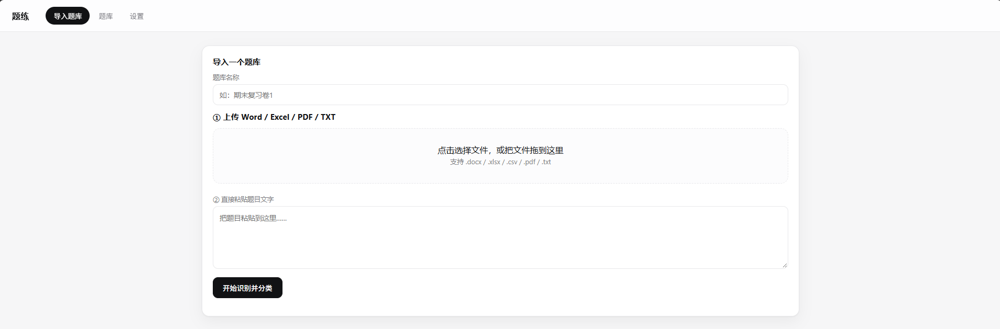
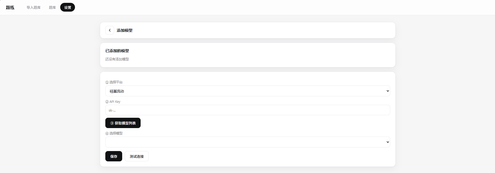

# 题练

<p>
  
  
  
  
</p>

一个跑在本地的刷题工具。把题库导进来，按题型刷、刷错题、刷收藏，考前来一轮模拟考试。

数据全在自己电脑上，不联网也能用。



## 特性

- **多格式导入** — docx、xlsx、csv、pdf、txt 都能读。xlsx 按列直读，千题量一两秒入库；其余格式按题号切块抽选项和答案，规则没覆盖到的段落再交给大模型补
- **按题型刷** — 单选、多选、判断分别统计，顺序刷支持断点续刷，另有只刷错题和只刷收藏两种模式
- **答题卡** — 左侧实时显示每题状态，没做白色、答对黑色、答错红色，点格子直接跳转
- **模拟考试** — 按题型设题数、分值、时长和及格线，交卷后给分并逐题批改，记录可回看，也能针对某次考试重练错题
- **AI 讲解** — 答错的题点一下就能获取解析，结果写回题目，下次不用重复请求
- **数据兜底** — 每次启动自动备份，保留最近 10 份；支持手动备份、一键恢复、清空作答记录

## 快速开始

**环境要求**：Python 3.9 或更高版本。

```bash
# 1. 安装依赖
pip install -r requirements.txt

# 2. 启动服务
python app.py
```

浏览器访问 <http://127.0.0.1:5000>。Windows 用户也可以直接双击 `启动.bat`。

服务只监听 `127.0.0.1`，局域网内其他设备访问不到。

## 界面

题库详情页。上方是刷题统计，下面是进入各模式的入口：顺序刷全部、只刷错题、收藏夹、模拟考试。


## 配置模型

导入时的兜底解析和答错后的 AI 讲解需要大模型支持。打开「设置 → 添加模型」，选择平台、填 API Key，点「获取模型列表」拉取可用模型，选中后保存即可。



接口按 OpenAI 兼容格式调用，下面这些平台的地址都能直接用：

| 平台 | 接口地址 |
| --- | --- |
| 硅基流动 | `https://api.siliconflow.cn/v1` |
| DeepSeek | `https://api.deepseek.com/v1` |
| Kimi | `https://api.moonshot.cn/v1` |
| 阿里云百炼 | `https://dashscope.aliyuncs.com/compatible-mode/v1` |
| 智谱 GLM | `https://open.bigmodel.cn/api/paas/v4` |

不配置也能正常刷题，只是少了解析兜底和讲解两项功能。

## 数据

运行后会在根目录生成三个东西，都写进 `.gitignore` 了，不会跟仓库走：

| 路径 | 用途 |
| --- | --- |
| `data.db` | 题库、作答记录、错题、收藏、考试记录 |
| `config.json` | 模型配置，含 API Key |
| `backups/` | 数据库定时备份 |

想换台电脑继续用，把 `data.db` 复制过去就行。

## 项目结构

```
QuizDeck/
├── app.py              后端：解析、入库、练习、考试、备份
├── static/
│   └── index.html      前端：全部页面和样式
├── images/             README 用的截图
├── requirements.txt
└── 启动.bat
```

没有前端构建步骤，`index.html` 直接由 Flask 提供，改完刷新浏览器就生效。

## 常见问题

**端口被占用**

```bash
# 查占用 5000 端口的进程
netstat -ano | findstr :5000

# 结束该进程
taskkill /PID <进程号> /F
```

**题库名显示成乱码或一串字母**

浏览器上传时偶尔会把临时文件名当题库名，导入完成后在题库卡片右上角的「⋯」里改名即可。

**导入卡住不动**

先看进度条有没有在走。如果停在某个百分比，多半是这段文本模型解析失败，可以在设置里换个模型再试，或者把这份文件另存为 xlsx 后重新导入。

## 许可

个人项目，未附加开源协议。如需转载或二次分发，请先联系作者。
